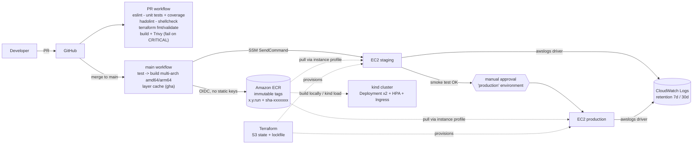
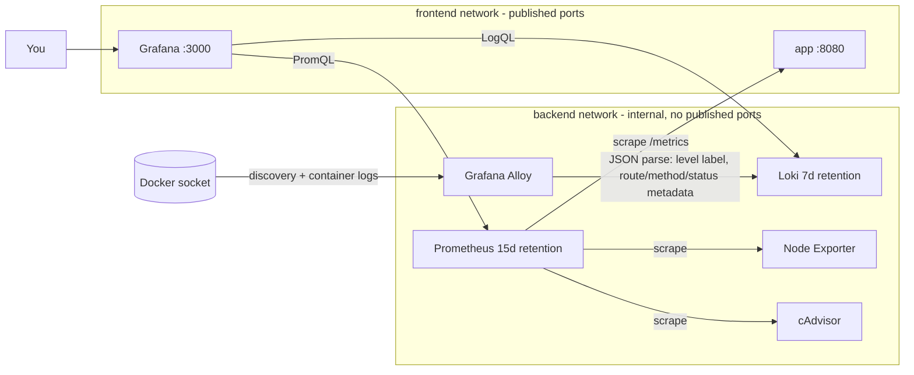

# DevOps Task - build, ship, deploy and observe a small web service

A tiny Node.js service taken from source to a **containerised, tested, scanned, multi-arch, deployed (EC2 + Kubernetes) and fully observable** state, with every piece defined as code.

| Area | Where |
|---|---|
| App (Node 22, zero runtime dependencies) | [`app/`](app) |
| Docker / Compose | [`app/Dockerfile`](app/Dockerfile), [`docker-compose.yml`](docker-compose.yml) |
| CI/CD | [`.github/workflows/`](.github/workflows) |
| Terraform (AWS) | [`terraform/`](terraform) (+ one-time [`bootstrap/`](terraform/bootstrap)) |
| Kubernetes (kind) | [`k8s/`](k8s) |
| Observability | [`docker-compose.monitoring.yml`](docker-compose.monitoring.yml), [`monitoring/`](monitoring) |
| Health script | [`scripts/system_health.sh`](scripts/system_health.sh) |

---

## 1. Quick start

### Prerequisites

| Tool | Needed for | Version used |
|---|---|---|
| Docker + Compose v2 | app, observability | Docker 24+ |
| Node.js | tests/lint outside Docker | 22.x |
| `shellcheck` | script lint | 0.9+ |
| Terraform | IaC | >= 1.10 |
| AWS account + CLI | EC2 deploy (optional to run) | v2 |
| `kind`, `kubectl` | Kubernetes | kind 0.24+, kubectl 1.30+ |

### Run the app

```bash
docker compose up -d --build
curl localhost:8080/          # {"message":"Hello from DevOps Task!","status":"running","version":"1.0.0"}
curl localhost:8080/health    # {"status":"ok"}
curl localhost:8080/metrics   # Prometheus text format
docker compose ps             # STATUS shows (healthy)
```

### Run the app + observability stack

```bash
cp .env.example .env                  # then edit GRAFANA_ADMIN_PASSWORD
docker compose -f docker-compose.yml -f docker-compose.monitoring.yml up -d --build
open http://localhost:3000            # login with the credentials from .env
```

Dashboards live in the **DevOps Task** folder: *Application*, *Host (Node Exporter)*, *Containers (cAdvisor)*. Alert rules are visible in Grafana under *Alerting -> Alert rules* (data-source-managed rules from Prometheus).

Generate some traffic, including errors (set `ENABLE_CHAOS=true` in `.env`, then `docker compose ... up -d`):

```bash
for i in $(seq 1 200); do curl -s localhost:8080/ >/dev/null; curl -s localhost:8080/boom >/dev/null; sleep 0.1; done
```

### Run the tests / linters

```bash
cd app
npm test                    # 12 unit tests (node:test, no dependencies)
npm run test:coverage       # fails below 80% line coverage (currently ~98%)
npm run lint                # eslint 9 via npx
shellcheck scripts/*.sh
```

### Run the health script

```bash
./scripts/system_health.sh                       # text, appends to ./health_log.txt
./scripts/system_health.sh --json --disk 70      # JSON (one object per run)
./scripts/system_health.sh --cpu 80 --mem 80 --disk 80 --crit 95 ; echo $?   # 0 healthy / 1 warning / 2 critical
./scripts/system_health.sh --help
```

Schedule it every 5 minutes with the systemd timer (`scripts/systemd/system-health.{service,timer}`) or cron (`scripts/systemd/system-health.cron`). Terraform user data installs and enables the timer on the EC2 instance automatically.

### Run Terraform

```bash
# 1) once per account: state bucket, ECR repo, GitHub OIDC role
cd terraform/bootstrap
terraform init
terraform apply -var state_bucket_name=<globally-unique-bucket> -var github_repository=<owner>/<repo>
#    note the outputs: ecr_repository_url, github_actions_role_arn

# 2) per environment (separate state key per environment, same code)
cd ..
terraform init -backend-config=envs/staging.backend.hcl -backend-config="bucket=<state-bucket>"
terraform plan  -var-file=envs/staging.tfvars -out=staging.tfplan
terraform apply staging.tfplan
# production: terraform init -reconfigure -backend-config=envs/prod.backend.hcl -backend-config="bucket=<state-bucket>"
#             terraform plan -var-file=envs/prod.tfvars
terraform destroy -var-file=envs/staging.tfvars     # clean up after testing
```

### Run on Kubernetes (kind)

```bash
make kind-up        # cluster + ingress-nginx + metrics-server
make kind-deploy    # build image, load into kind, kubectl apply -k k8s
curl http://app.localtest.me/     # via Ingress (localtest.me resolves to 127.0.0.1)
# Port-forward alternative:  kubectl -n devops-task port-forward svc/app 8081:80  &&  curl localhost:8081/
```

#### Zero-downtime rolling update and rollback

```bash
# terminal 1: continuously hit the Ingress and report any non-200
./scripts/k8s-zero-downtime-check.sh http://app.localtest.me/ 90

# terminal 2: ship v1.0.1
docker build -t devops-task-app:1.0.1 --build-arg VERSION=1.0.1 app
kind load docker-image devops-task-app:1.0.1 --name devops-task
kubectl -n devops-task set image deployment/app app=devops-task-app:1.0.1
kubectl -n devops-task annotate deployment/app kubernetes.io/change-cause="release 1.0.1" --overwrite
kubectl -n devops-task rollout status deployment/app
curl http://app.localtest.me/                               # "version":"1.0.1"

# roll back
kubectl -n devops-task rollout history deployment/app
kubectl -n devops-task rollout undo deployment/app
kubectl -n devops-task rollout status deployment/app
curl http://app.localtest.me/                               # "version":"1.0.0" again
```

Why it is zero-downtime: `maxUnavailable: 0` + `maxSurge: 1` (a new pod must be *Ready* before an old one is removed), readiness probe on `/health`, a `preStop` sleep so the endpoint is removed from the Service before SIGTERM, and the app flips `/health` to 503 and drains in-flight requests on SIGTERM.

> **Evidence (replace before submitting):** paste the real `rollout status` / `rollout history` / `rollout undo` output and the `k8s-zero-downtime-check.sh` summary (`requests ok=N failed=0`) here.

#### Secrets in Kubernetes

No secret is committed. `k8s/secret.env` is git-ignored (template: `secret.env.example`); kustomize's `secretGenerator` builds the `app-secret-<hash>` Secret at apply time, and the hash suffix triggers a rollout when the value changes. In production use External Secrets Operator / Secrets Store CSI driver backed by AWS Secrets Manager (see EKS notes) or Sealed Secrets for GitOps.

#### What changes on EKS

| Concern | kind (this repo) | EKS in production |
|---|---|---|
| Ingress | ingress-nginx on a port mapping | AWS Load Balancer Controller -> ALB (TLS from ACM, WAF), `Ingress` with `alb` class |
| Secrets | kustomize `secretGenerator` | External Secrets Operator or Secrets Store CSI Driver reading AWS Secrets Manager / SSM; envelope encryption of etcd with KMS |
| Pod AWS access | none needed | IAM Roles for Service Accounts (IRSA) or EKS Pod Identity; no node-wide instance-profile permissions |
| Node scaling | fixed single node | Karpenter (or Cluster Autoscaler) so HPA scale-out gets nodes; multiple AZs; topology spread constraints |
| Images | `kind load` | pull from ECR (node role has read-only ECR), digests pinned, signature verified by admission policy |
| Metrics | metrics-server | metrics-server + kube-prometheus-stack, Alloy as a DaemonSet for logs |
| Networking | default | VPC CNI, default-deny `NetworkPolicy`, private subnets, VPC endpoints |
| Delivery | `kubectl apply -k` | Argo CD / Flux GitOps, Argo Rollouts for canary |

---

## 2. Architecture





---

## 3. Design decisions

**Language: Node.js with zero runtime dependencies.** Prometheus text exposition is a small, stable format, so the app renders it itself (counter, error counter, histogram). Result: no `node_modules`, no lockfile churn, nothing for Trivy to flag in app dependencies, and a build that works offline. The trade-off is that I own a ~100-line metrics module (unit-tested); a real service would normally use `prom-client`.

**Alpine vs distroless.** The final image is `node:22.11.0-alpine3.20`, pinned to an exact version, with `npm`, `npx` and `yarn` deleted (never used at runtime, and the usual source of Trivy findings), running as UID 1000. Distroless (`gcr.io/distroless/nodejs22`) removes the shell/apk entirely and is the better choice when you can pin by digest in a reproducible way; I picked Alpine because a pinned version tag is verifiable by anyone, the `HEALTHCHECK` is simple, and the shell makes incident debugging easier. The Node binary dominates the size either way. Production hardening step: pin `@sha256:` digests and let Renovate/Dependabot bump them.

> **Final image size (replace before submitting):** run `docker images devops-task-app` and paste the value here. Expect roughly 120-140 MB uncompressed (the Node runtime is ~100 MB of that).

**Tests run inside the Docker build** (build stage executes `node --test`), so an image with failing tests cannot be produced even locally.

**EC2 vs ECS vs EKS.** The task's target is a single small service: EC2 + Docker is the cheapest and simplest thing that is still fully IaC and reproducible (about $20/month for prod). ECS Fargate would remove host patching and give rolling deploys for free, and is where I would go first when the service needs more than one instance; EKS is justified only for many services or when Kubernetes is already the platform. The Kubernetes part of this repo shows the deployment model I'd use there.

**Tagging.** Every image gets an **immutable** `MAJOR.MINOR.<run_number>` semantic version (MAJOR.MINOR from `app/package.json`, patch = CI run number so it is unique and monotonic) and `sha-<7 chars>`. ECR tags are immutable, so a tag can never silently change. `latest` is never used. Deploys reference the `sha-` tag (traceable to a commit); rollback uses the previously recorded tag.

**Secrets.** Nothing is committed. CI uses GitHub **OIDC** to assume an AWS role (no access keys). The instances use an instance profile. The app reads config from environment variables; Kubernetes secrets come from a git-ignored file via `secretGenerator`; Grafana's admin password is required from `.env` (`${GRAFANA_ADMIN_PASSWORD:?...}` makes compose fail if unset).

**Remote state.** S3 with versioning, encryption and public access blocked; locking uses the native S3 lockfile (`use_lockfile`, Terraform >= 1.10), so no DynamoDB table to maintain. Staging and production share code and differ by `-var-file` and backend key.

**No SSH.** The security group opens only the app port inbound; operators use SSM Session Manager and CI deploys through SSM, so there is no inbound 22 and no key pair to manage.

**Network layout in Compose.** `frontend` carries the only published ports (app 8080, Grafana 3000); `backend` is `internal: true` so Prometheus, Loki, Alloy, Node Exporter and cAdvisor cannot be reached from the host and have no internet route.

### Log label choices (Loki)

| Field | Stored as | Why |
|---|---|---|
| `service`, `container` | **label** | from Docker discovery; a handful of values |
| `level` | **label** | 4 possible values; the most common filter (`level=~"error\|warn"`) deserves the index |
| `route`, `method`, `status` | **structured metadata** | filterable (`\| route="/boom"`) but not indexed, so no stream explosion. `route` is already normalised by the app to an allow-list + `unmatched` |
| raw `path`, `duration_ms`, `time` | stays in the JSON line | unbounded cardinality (random URLs would create a stream per URL); read with `\| json` |

Rule of thumb applied: label only what you filter on constantly *and* what has a small, bounded set of values. The same reasoning is behind the app's `route` metric label.

### Alert rules and thresholds

| Alert | Expression (short) | `for` | Reasoning |
|---|---|---|---|
| `AppInstanceDown` | `up{job="app"} == 0` | 1m | Four missed 15s scrapes: long enough to ignore a restart blip, short enough to page quickly. Critical. |
| `AppHighErrorRate` | 5xx ratio > 5% **and** > 0.1 req/s | 5m | Ratio (not count) scales with traffic; the traffic floor prevents 1 failed request out of 2 from paging at 3 a.m.; 5m filters brief spikes. Critical. |
| `AppHighLatencyP95` | p95 > 500 ms | 10m | The service answers in single-digit ms, so 500 ms is a clear regression; 10m avoids paging on noise. Warning. |
| `HostDiskUsageHigh` | any real filesystem > 80% | 15m | 80% leaves time to react; disks fill slowly so a long `for` costs nothing and avoids flapping around log rotation. Warning. |
| `HostHighCpu` | CPU > 90% | 15m | Sustained saturation only; short bursts are normal. Warning. |
| `HostMemoryLow` | `MemAvailable` < 10% | 10m | Uses *available* (not free) memory so page cache doesn't cause false positives. Warning. |
| `ContainerMemoryNearLimit` | working set / limit > 90% | 5m | The OOM killer acts on the working set; 90% leaves a short runway to react before a kill. Warning. |

Routing (Alertmanager -> Slack/Discord) is not set up; see *What I would improve*.

### Hardening granted to the observability containers (and why)

| Container | Mounts / privileges | Why |
|---|---|---|
| Node Exporter | `pid: host`; `/:/host:ro,rslave`; `--path.rootfs=/host`; all capabilities dropped | read host `/proc`, `/sys`, filesystem stats. Read-only; not `privileged`; no published port |
| cAdvisor | read-only `/`, `/sys`, `/var/lib/docker`, `/dev/disk`, `/var/run`; device `/dev/kmsg` | read cgroups and Docker metadata for per-container stats and OOM events. If metrics are empty on your host (SELinux, some Docker Desktop versions) add `privileged: true`: a known cAdvisor trade-off |
| Alloy | read-only `/var/run/docker.sock` | Docker service discovery and log collection. **The Docker socket is root-equivalent**: a `:ro` mount does not restrict API calls, so Alloy is trusted. Production alternative: ship logs by the Docker `loki`/`awslogs` driver or a node agent with scoped access |

Known caveat: Node Exporter runs on the bridge network so Prometheus can reach it by name; its *network* panels therefore show its own network namespace, and the filesystem/CPU/memory panels show the host. For true host NIC metrics use `network_mode: host` and bind it to a private address.

---

## 4. CI/CD

**`pr.yml`** (every pull request): eslint, unit tests with an 80% coverage gate (summary in the job page, lcov artifact), hadolint, shellcheck, compose + Prometheus rule validation, `terraform fmt/validate`, then build the image and run **Trivy: report HIGH+CRITICAL, fail on CRITICAL**. `ignore-unfixed: true` means it fails on criticals that have a fix available (actionable); drop the flag for a stricter policy.

**`main.yml`** (push to `main`): tests -> multi-arch (`linux/amd64`, `linux/arm64`) build with GitHub Actions layer cache -> push to ECR (OIDC) -> deploy **staging** via SSM -> **production** (manual approval through the `production` environment).

### Required configuration (no secrets in the repo)

| Name | Type | Where | Value |
|---|---|---|---|
| `AWS_ROLE_ARN` | variable | repo variables | `github_actions_role_arn` output of `terraform/bootstrap` |
| `AWS_REGION` | variable | repo variables | e.g. `us-east-1` |
| `ECR_REPOSITORY` | variable | repo variables | `devops-task-app` |
| Environments `staging`, `production` | environment | Settings -> Environments | add *Required reviewers* to `production` |

There are **no GitHub secrets at all**: authentication is OIDC; the role's trust policy only accepts tokens from this repository's `main` branch / environments, never from pull requests.

> **Evidence (replace before submitting):** link a successful `main` workflow run, or add screenshots of the build-push, deploy-staging and deploy-production jobs, and of a green PR run showing Trivy.

---

## 5. Deployment & rollback strategy

1. A PR must pass every check (lint, tests, scans) before merge.
2. Merge to `main` builds **one** immutable multi-arch image, tagged `1.0.<run>` and `sha-<sha>`.
3. **Staging** is deployed automatically. On the instance, `deploy-app.sh` pulls the image, replaces the container, then polls `GET /health` (30 tries x 2 s). 
4. **Production** deploys the exact same image only after staging succeeded **and** a reviewer approved.
5. **Automatic rollback:** if the smoke test fails, `deploy-app.sh` immediately restarts the previously deployed tag (recorded in `/opt/app/current_image`), re-checks it, and exits non-zero so the workflow turns red.
6. **Manual rollback:** re-run the deploy job of an older commit (the old `sha-` tag still exists - ECR tags are immutable), or on the host: `aws ssm start-session --target <id>` then `deploy-app.sh <old-image>`.
7. Kubernetes: `kubectl rollout undo deployment/app`.

Trade-off: a single EC2 instance has a few seconds of downtime during the container swap. The next step is an ALB with two instances (or ECS) for rolling/blue-green behaviour.

---

## 6. Security considerations

- **Secrets:** none in git; OIDC for CI; instance profile for runtime; Grafana credentials from env; Kubernetes secret generated from an untracked file.
- **Images:** pinned base versions, multi-stage, non-root (UID 1000), read-only root filesystem, all capabilities dropped, `no-new-privileges`, npm/yarn removed, HEALTHCHECK, OCI labels, `.dockerignore`. Trivy gates every PR; ECR also scans on push.
- **IAM:** instance role = SSM core + pull from *one* ECR repo + `CreateLogStream/PutLogEvents` on *one* log group. CI role = push to *one* repo + `ssm:SendCommand` only on instances tagged `Project=devops-task` + read command results. No wildcard admin anywhere; no static keys.
- **Network:** inbound only the app port from `allowed_cidrs` (tighten in `envs/*.tfvars`); no SSH; egress limited to 443; IMDSv2 required; EBS encrypted. In Compose, only app and Grafana publish ports.
- **Supply chain:** actions are pinned to major versions; improvement is pinning to commit SHAs and signing images (Cosign) + SBOM.
- **Kubernetes:** namespace enforces the `restricted` Pod Security Standard; `runAsNonRoot`, seccomp `RuntimeDefault`, no service-account token mounted, resource limits, PodDisruptionBudget.

---

## 7. Rough monthly AWS cost (us-east-1, on-demand, approximate)

| Item | Staging | Production |
|---|---|---|
| EC2 (`t3.micro` / `t3.small`) | ~$7.6 | ~$15.2 |
| EBS gp3 (12 GB / 16 GB) | ~$1.0 | ~$1.3 |
| Public IPv4 address | ~$3.7 | ~$3.7 |
| CloudWatch Logs (ingest ~1-2 GB) | ~$0.5 | ~$1.0 |
| ECR (~1 GB, shared), S3 state, SSM | ~$0.2 (shared) | |
| **Total** | **~$13** | **~$21-22** |

Both environments: **about $35/month**. Adding an Application Load Balancer for production adds roughly $16-22/month. Running the monitoring stack on EC2 would need at least a `t3.medium` (~$30/month) or Amazon Managed Prometheus/Grafana. Prices change; verify with the AWS Pricing Calculator. Staging is destroyed after testing, so the real cost during assessment is near zero.

---

## 8. What I would improve with more time

- Alertmanager with Slack/Discord routing, runbook links in every alert, and SLO-based burn-rate alerts.
- ALB + Auto Scaling group (or ECS Fargate) for zero-downtime deploys, TLS via ACM, private subnets and VPC endpoints instead of public IPs.
- Pin base images and Actions by digest/SHA with Renovate; Cosign signing and SBOM attestation in CI; Trivy `config` scan for Terraform and Kubernetes.
- Helm chart with `values-staging.yaml` / `values-production.yaml`, or kube-prometheus-stack on the cluster, plus OpenTelemetry tracing into Tempo.
- Terraform split into reusable modules, `tflint`/`checkov` in CI, and `terraform plan` posted as a PR comment.
- Contract/smoke tests that run against staging from CI (not only on the host) and automatic GitHub Releases from semantic-release.
- Node Exporter on the host network for exact NIC metrics, and an Ansible playbook for host hardening.

---

## 9. Use of AI tools

I used AI assistance through Copilot SDK in VS Code to scaffold and review parts of the implementation and documentation, including workflows, Terraform, Compose/monitoring configuration, dashboard JSON, scripts, and README sections. I reviewed the changes, ran available validation and tests, and can explain every included design decision and trade-off.

---

## Repository layout

```
app/                    service, tests, Dockerfile
docker-compose.yml      app (port 8080, healthcheck, restart policy, resource limits)
docker-compose.monitoring.yml   Prometheus, Grafana, Loki, Alloy, Node Exporter, cAdvisor
monitoring/             prometheus rules, loki config, alloy pipeline, grafana provisioning + 3 dashboards
tools/                  dashboard generator (JSON in monitoring/grafana/dashboards is the source of truth)
terraform/              EC2 stack (+ bootstrap/ for state bucket, ECR, GitHub OIDC)
k8s/                    kustomize manifests + kind config
scripts/                system_health.sh, deploy-app.sh, ci-deploy.sh, systemd units, k8s check
.github/workflows/      pr.yml, main.yml
```

## Screenshots

> Replace these with real screenshots from your run (Grafana at <http://localhost:3000>). Save them in `docs/screenshots/`.

| Dashboard | Screenshot |
|---|---|
| Application | `` |
| Host | `` |
| Containers | `` |

## Walkthrough: "An error spike appears on the Application dashboard. How do you find the cause?"

1. **Scope it (Application dashboard, metrics).** The *Error rate (5xx)* panel shows when it started and its size; *Request rate by route* and *by status* show **which route** returns 5xx. Here, `/boom` carries all the errors while `/` is healthy, so it is not a total outage. Latency percentiles tell us whether it is failing fast or timing out.
2. **Read the evidence (same dashboard, logs).** The *error & warning logs* panel below the graphs uses the same time range. Brush-select the spike on any graph and the logs narrow to that window. Each line is JSON (`msg`, `route`, `status`, `duration_ms`) and `level` is a label, so the query `{service="app", level="error"}` is instant. Add `| route="/boom"` to isolate a route.
3. **Correlate with the platform (Containers dashboard).** Is memory near the limit (*Memory usage relative to limit*)? CPU throttled? Did the container restart (memory/uptime reset)? If so, the cause is resources, not code.
4. **Rule out the host (Host dashboard).** CPU saturation, memory pressure, or disk above 80% would affect every container.
5. **Check what changed.** `app_info{version=...}` and the container's image tag tell whether the spike began right after a deploy. If so, roll back (`deploy-app.sh <previous>` / `kubectl rollout undo`) first and debug afterwards.
6. **Confirm and close.** After the fix, the error ratio returns to 0 and `AppHighErrorRate` resolves.
